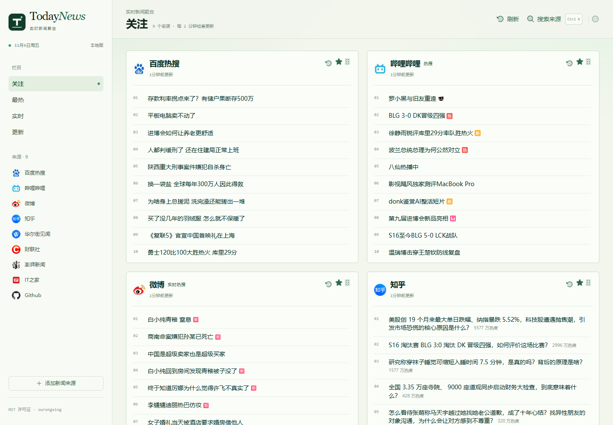

# TodayNews Local

**本地地址：http://127.0.0.1:5188/c/focus** · **[本地启动、数据机制与校验说明](本地使用说明.md)**

本目录为可独立运行的本地版本：品牌名 **TodayNews**，采用浅绿“编辑部工作台”布局、新 Logo、左侧来源索引与右侧新闻版面，保留真实采集、搜索、关注和自动刷新。本地配置、启动方式与校验命令见[本地使用说明](本地使用说明.md)；下方上游项目文档仅作参考。

## 界面预览

桌面版（http://127.0.0.1:5188/c/focus）：



手机版：


English | [简体中文](README.zh-CN.md) | [日本語](README.ja-JP.md)

> [!NOTE]
> NewsNext, the next gen of NewsNow, is coming soon, join the [waitlist](https://tally.so/r/yPBBYg).

**_Elegant reading of real-time and hottest news_**

## Features

- Light-green “editorial workbench” layout: category/source index on the left, news cards on the right
- Real-time scraping by the local Node server — no demo data and no upstream aggregation API
- Manual refresh per column or card; visible pages check for new data every 2 minutes
- Source search, follow/unfollow and drag-to-sort, saved in the current browser
- SQLite cache under `.data/`, initialized automatically; no account login required locally
- Adaptive scraping interval (minimum 2 minutes) to avoid source rate limits
- Mobile layout with top tabs, horizontally swiped cards, vertically scrolling content

## Deployment

### Basic Deployment

For deployments without login and caching:

1. Fork this repository
2. Import to platforms like Cloudflare Page or Vercel

### Cloudflare Page Configuration

- Build command: `pnpm run build`
- Output directory: `dist/output/public`

### GitHub OAuth Setup

1. [Create a GitHub App](https://github.com/settings/applications/new)
2. No special permissions required
3. Set callback URL to: `https://your-domain.com/api/oauth/github` (replace `your-domain` with your actual domain)
4. Obtain Client ID and Client Secret

### Environment Variables

Refer to `example.env.server`. For local development, rename it to `.env.server` and configure:

```env
# Github Client ID
G_CLIENT_ID=
# Github Client Secret
G_CLIENT_SECRET=
# JWT Secret, usually the same as Client Secret
JWT_SECRET=
# Initialize database, must be set to true on first run, can be turned off afterward
INIT_TABLE=true
# Whether to enable cache
ENABLE_CACHE=true
```

### Database Support

Supported database connectors: https://db0.unjs.io/connectors
**Cloudflare D1 Database** is recommended.

1. Create D1 database in Cloudflare Worker dashboard
2. Configure database_id and database_name in wrangler.toml
3. If wrangler.toml doesn't exist, rename example.wrangler.toml and modify configurations
4. Changes will take effect on next deployment

### Docker Deployment

In project root directory:

```sh
docker compose up
```

You can also set Environment Variables in `docker-compose.yml`.

## Development

> [!Note]
> Requires Node.js >= 20

```sh
corepack enable
pnpm i
pnpm dev
```

### Adding Data Sources

Refer to `shared/sources` and `server/sources` directories. The project provides complete type definitions and a clean architecture.

For detailed instructions on how to add new sources, see [CONTRIBUTING.md](CONTRIBUTING.md).

## Roadmap

- Add **multi-language support** (English, Chinese, more to come).
- Improve **personalization options** (category-based news, saved preferences).
- Expand **data sources** to cover global news in multiple languages.

**_release when ready_**


## Contributing

~~Contributions are welcome! Feel free to submit pull requests or create issues for feature requests and bug reports.~~

The new version is coming soon and we will no longer accept contributions

~~See [CONTRIBUTING.md](CONTRIBUTING.md) for detailed guidelines on how to contribute, especially for adding new data sources.~~

## License

[MIT](./LICENSE) © ourongxing
