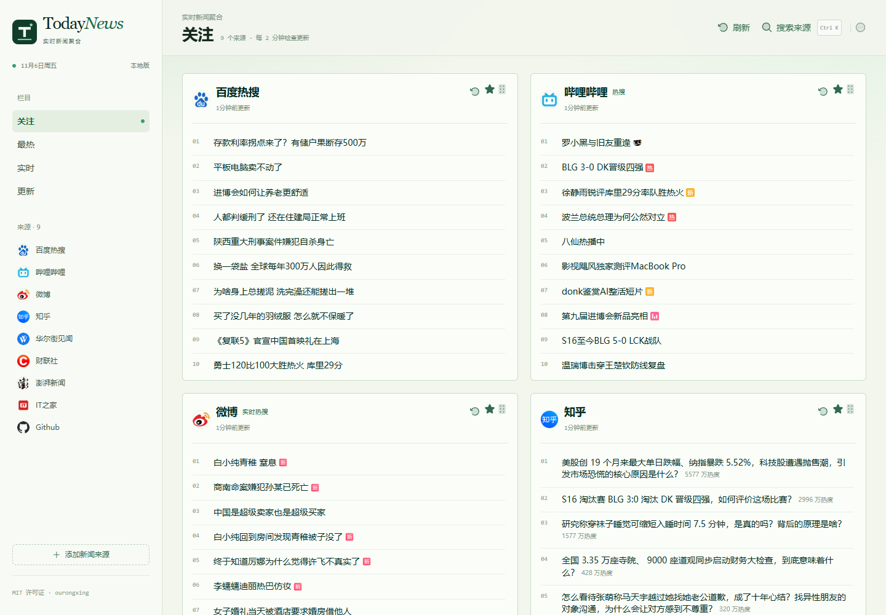

## 界面预览

桌面版（http://127.0.0.1:5188/c/focus）：



手机版：


[English](./README.md) | 简体中文 | [日本語](README.ja-JP.md)

***优雅地阅读实时热门新闻***

> [!NOTE]
> NewsNext（下一代 NewsNow）即将到来，快加入 [等待名单](https://tally.so/r/lbxxbo) 吧。

## 功能特性

- 浅绿“编辑部工作台”布局：左侧栏目与来源索引，右侧新闻卡片版面
- 本地 Node 服务直接采集各平台，无示例数据、不依赖上游聚合 API
- 栏目/卡片可单独刷新，可见页面每 2 分钟检查新数据
- 来源搜索、关注与取消关注、拖拽排序，保存在当前浏览器
- SQLite 缓存自动保存在 `.data/`，本地无需登录账号
- 按来源更新频率自适应抓取间隔（最快 2 分钟），避免触发限流
- 手机端顶部栏目导航、横向滑动卡片、内容纵向滚动

## 部署指南

### 基础部署
无需登录和缓存功能时，可直接部署至 Cloudflare Pages 或 Vercel：
1. Fork 本仓库
2. 导入至目标平台

### Cloudflare Pages 配置
- 构建命令：`pnpm run build`
- 输出目录：`dist/output/public`

### GitHub OAuth 配置
1. [创建 GitHub App](https://github.com/settings/applications/new)
2. 无需特殊权限
3. 回调 URL 设置为：`https://your-domain.com/api/oauth/github`（替换 your-domain 为实际域名）
4. 获取 Client ID 和 Client Secret

### 环境变量配置
参考 `example.env.server` 文件，本地运行时重命名为 `.env.server` 并填写以下配置：

```env
# Github Clien ID
G_CLIENT_ID=
# Github Clien Secret
G_CLIENT_SECRET=
# JWT Secret, 通常就用 Clien Secret
JWT_SECRET=
# 初始化数据库, 首次运行必须设置为 true，之后可以将其关闭
INIT_TABLE=true
# 是否启用缓存
ENABLE_CACHE=true
```

### 数据库支持
本项目主推 Cloudflare Pages 以及 Docker 部署， Vercel 需要你自行搞定数据库，其他支持的数据库可以查看 https://db0.unjs.io/connectors 。

1. 在 Cloudflare Worker 控制面板创建 D1 数据库
2. 在 `wrangler.toml` 中配置 `database_id` 和 `database_name`
3. 若无 `wrangler.toml` ，可将 `example.wrangler.toml` 重命名并修改配置
4. 重新部署生效

### Docker 部署
对于 Docker 部署，只需要项目根目录 `docker-compose.yaml` 文件，同一目录下执行
```
docker compose up
```
同样可以通过 `docker-compose.yaml` 配置环境变量。

## 开发
> [!Note]
> 需要 Node.js >= 20

```bash
corepack enable
pnpm i
pnpm dev
```

你可能想要添加数据源，请关注 `shared/sources` `server/sources`，项目类型完备，结构简单，请自行探索。

## 路线图
- 添加 **多语言支持**（英语、中文，更多语言即将推出）
- 改进 **个性化选项**（基于分类的新闻、保存的偏好设置）
- 扩展 **数据源** 以涵盖多种语言的全球新闻

## 贡献指南
~~欢迎贡献代码！您可以提交 pull request 或创建 issue 来提出功能请求和报告 bug~~

新版即将到来，当前版本将不再接受贡献。

## License

[MIT](./LICENSE) © ourongxing

<a href="https://hellogithub.com/repository/c2978695e74a423189e9ca2543ab3b36" target="_blank"></a>
